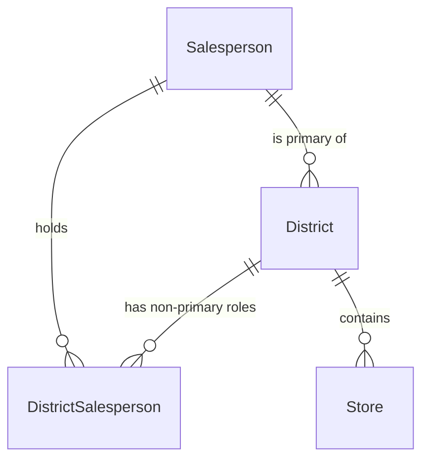

# Sales Districts

Salespeople, districts and stores. A district always has exactly one primary salesperson and may have secondary salespeople; a store belongs to one district.

- **Database:** SQL Server, with the business rules enforced by constraints and triggers
- **API:** ASP.NET Core minimal API (.NET 10), hand-written SQL with Dapper
- **Client:** WPF using MVVM (CommunityToolkit.Mvvm), talking only to the API

## Running it

**Prerequisites:** Windows, the .NET 10 SDK, and SQL Server Express (or any SQL Server; change the connection string in `src/SalesDistricts.Api/appsettings.Development.json`). Docker is needed only for the integration tests.

1. Open `SalesDistricts.slnx` in Rider or Visual Studio.
2. Run the compound configuration in `.run/`, which starts the API and the WPF app together.
3. On first start the API creates the `SalesDistricts` database and loads the test data.

From the command line:

```bash
dotnet run --project src/SalesDistricts.Api --launch-profile https
dotnet run --project src/SalesDistricts.Wpf
```

The API is documented at `https://localhost:7217/scalar`. Example requests are in `src/SalesDistricts.Api/SalesDistricts.Api.http`.

Authentication is switched off in Development (`Authentication:Enabled` in `appsettings.Development.json`). The API refuses to start with it switched off in any other environment.

## Solution structure

| Project | Responsibility |
|---|---|
| `database/` | Schema and test data as numbered T-SQL scripts, applied by DbUp when the API starts |
| `src/SalesDistricts.Api` | Endpoints (HTTP only) → services (business rules) → repositories (SQL via Dapper) |
| `src/SalesDistricts.Client` | ViewModels and the typed API client. No WPF dependency, so it is testable anywhere |
| `src/SalesDistricts.Wpf` | XAML views, dependency injection (Generic Host), the dialog service |
| `tests/SalesDistricts.Api.UnitTests` | Services and authorization handlers, with fakes |
| `tests/SalesDistricts.Api.IntegrationTests` | Database rules and the API end to end, against SQL Server in a container |
| `tests/SalesDistricts.Client.Tests` | ViewModels and the API client, with fakes |

## Data model

The diagram is in `docs/data-model.drawio`.



| Rule | Enforced by |
|---|---|
| A district always has exactly one primary | `District.PrimarySalespersonId` is a single `NOT NULL` foreign key |
| A salesperson can be primary for several districts | No unique constraint on that column |
| Secondary salespeople, no duplicates | `DistrictSalesperson` with primary key `(DistrictId, SalespersonId)` and a `Role` restricted by `CHECK` |
| The primary cannot also be a secondary in the same district | Two triggers, reading with `UPDLOCK, HOLDLOCK` so concurrent changes cannot both pass |
| A store belongs to exactly one existing district | `Store.DistrictId` is a `NOT NULL` foreign key |
| Unique, non-blank district names | `UNIQUE` and `CHECK` constraints |

Not enforced on purpose: that every salesperson belongs to a district. It would stop new salespeople being added before they are assigned.

**Alternatives considered:** a single assignment table for all roles (a filtered unique index gives at most one primary, but not at least one); copying the primary onto the secondary rows so a `CHECK` can compare them (no triggers, but it breaks normalisation); checking the rule only in the API (race conditions, and other writers bypass it).

## API

| Endpoint | Purpose |
|---|---|
| `GET /api/districts` | District list |
| `GET /api/districts/{id}` | A district with its primary, secondaries and stores |
| `GET /api/salespeople` | Salespeople, for choosing whom to add |
| `POST /api/districts/{id}/secondaries` | Add a secondary |
| `DELETE /api/districts/{id}/secondaries/{salespersonId}` | Remove a secondary |
| `PUT /api/districts/{id}/primary` | Set the primary; a current secondary is promoted and the previous primary leaves the district |

There is deliberately no way to delete a primary: it can only be replaced. Writes return the updated district.

Errors are ProblemDetails: 400 invalid request, 404 unknown district or assignment, 422 unknown salesperson, 409 a rule conflict. The service checks the rules first for a clear message; the database is the safety net for concurrent changes, and its errors are also returned as 409.

Reads require the `CanViewDistricts` policy and writes also `CanEditAssignments` (the `SalesManager` role from an Entra ID token).

## WPF client

- MVVM with CommunityToolkit.Mvvm. ViewModels live in `SalesDistricts.Client`, which does not reference WPF.
- The screen changes only after the API confirms a change; on an error it shows the reason and keeps the last confirmed state.
- Replacing the primary asks for confirmation, through `IDialogService` so the ViewModel stays testable.
- Selecting a district cancels any load still in progress, so the latest selection always wins.
- `HttpClient` comes from `IHttpClientFactory` with a resilience handler. Only GET requests are retried.

## Tests

```bash
dotnet test                                           # everything (Docker must be running)
dotnet test tests/SalesDistricts.Api.UnitTests        # no Docker needed
dotnet test tests/SalesDistricts.Client.Tests         # no Docker needed
```

The integration tests start SQL Server in a container with Testcontainers and apply the real migration scripts. Every business rule has a test against the real database; API tests run the real application with `WebApplicationFactory`. CI (`.github/workflows/ci.yml`) runs all tests on every push and publishes the API and its container image as build artifacts.

## Before production

- Turn authentication on: Entra ID app roles, the WPF client signing in with MSAL
- Run migrations as a separate deployment step rather than at API start-up
- A contract test running the client against the real API, or a client generated from the OpenAPI document
- Optimistic concurrency if two people editing the same district becomes realistic (currently last write wins)
- Auditing of assignment changes, for example with SQL Server temporal tables
